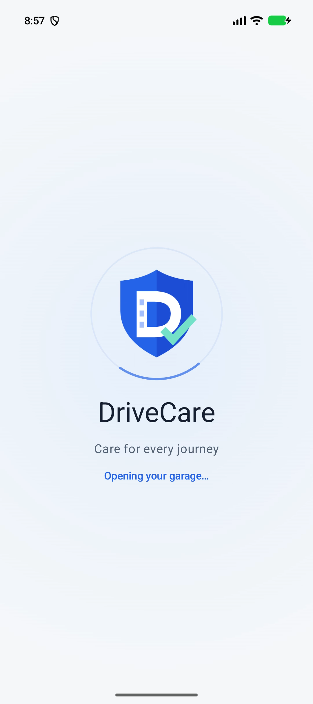
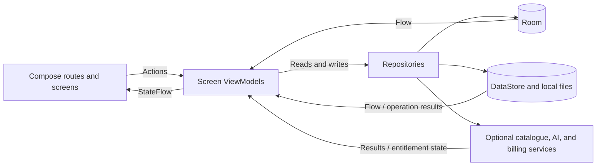

<div align="center">
  
  <h1>DriveCare</h1>
  <p>A native Android journal for fuel, maintenance, and the everyday costs of owning a car.</p>
  <p>
    
    
    
    
  </p>
</div>

## Demo

**YouTube demo:** [▶ Watch the demo on YouTube](https://youtu.be/FaYQmUfEQPc)

## Overview

DriveCare is my personal Android project for keeping vehicle history in one place:
what was spent, when work was completed, and what maintenance is coming next.
It is designed for car owners who want a practical record of ownership without
requiring an account for their local journal.

Vehicles, journal entries, maintenance plans, attachments, and saved AI answers are
stored on the device. Core tracking works offline. Optional online integrations
provide make/model suggestions, vehicle guidance, and a lifetime Pro purchase flow.
A fresh installation starts with an empty garage and journal.

## Key Features

| Area | Implemented behavior |
| --- | --- |
| Garage | Two-step vehicle setup, searchable make/model suggestions with manual entry, technical details, local photos with an expanded viewer, vehicle selection, and archiving. |
| Ownership journal | Create, edit, and delete fuel, service, expense, odometer, and note records. Search entries and filter by type or date; attach images or PDFs. |
| Fuel tracking | Record volume and total paid, full or partial fills, missing fills, and optional actual mileage. View weighted fuel prices and full-to-full consumption when eligible readings exist. |
| Mileage estimates | Explicitly opt into an estimate using an owner-entered average consumption. The overview keeps approximate mileage separate from the last actual reading. |
| Maintenance | Calendar and agenda views, date and/or distance thresholds, recurring intervals, warning windows, pause/resume, completion history, and notification reminders. |
| Statistics | Period presets and custom ranges, fuel/service/other spending separated by currency, purchased fuel volume, and monthly fuel charts with text values. |
| Data portability | Free CSV export of paid records and ZIP backup/replace-restore including photos, attachments, and saved advice. Files use Android's system document picker. |
| Personalization | English, Russian, and Ukrainian UI resources; light, dark, and system themes; independent distance, volume, currency, and reporting-time-zone settings. |

**Optional AI Garage.** Ask about maintenance, possible weak points, practical upgrades,
or recorded costs using Firebase AI Logic. Requests require consent and a configured
Firebase project. Validated structured answers are saved locally for offline reading;
users can open note or maintenance drafts and review them before saving. Photos and
receipt files are not sent to the AI service.

**DriveCare Pro.** The RevenueCat integration gates multiple active vehicles, advanced
spending breakdowns/comparisons, and paginated PDF reports behind a lifetime entitlement.
The free tier allows one active vehicle; archived history remains readable and
exportable. The paywall includes purchase restoration and uses the store-provided
price. Real purchases require Google Play and RevenueCat setup.

## Screenshots

<div align="center">
  
  <p><sub>Existing light-theme startup preview.</sub></p>
</div>

<!-- Add real feature-screen captures after recording the app: Overview with a vehicle,
Maintenance calendar and plan details, fuel entry, filtered Journal, and Statistics.
Include a dark-theme example. Store images in the repository and use relative paths.
The artwork in design/artwork/ is illustration material, not application screenshots. -->

## Tech Stack

Versions below describe the checked-in configuration, rather than a claim about the
latest available releases. Full pins and compatibility notes are in
[the version catalog](gradle/libs.versions.toml) and [Android stack notes](docs/android-stack.md).

| Technology | Purpose in this project |
| --- | --- |
| Kotlin 2.4.21 | Application code, immutable state models, validation, and ownership calculations. AGP built-in Kotlin is used with aligned Compose and serialization compiler plugins. |
| Jetpack Compose / Material 3 | Screens, forms, dialogs, themes, and responsive layouts; monthly fuel charts are drawn with Compose Canvas. Compose BOM: `2026.09.00`. |
| AndroidX ViewModel / Coroutines / StateFlow | Screen state, asynchronous operations, and combined database/preferences/billing updates; routes collect state with `collectAsStateWithLifecycle()`. |
| SavedStateHandle / Compose saved state | Preserve form drafts, filters, selections, onboarding progress, and navigation-related UI state across recreation where implemented. |
| Navigation 3 | Serializable destination keys, a saved back stack, and navigation-entry ViewModel stores for details, editors, garage, settings, and paywall. |
| Hilt / KSP | Constructor injection for ViewModels and repositories; generated Hilt wiring and Room database code. |
| Room 2.8.5 | Relational storage for vehicles, records, plans, attachments, and AI conversations; observable queries, foreign keys, transactions, and an explicit schema 1 → 2 migration. |
| Preferences DataStore | Selected vehicle, onboarding, display units, theme, reporting time zone, AI consent, and local AI usage counters. |
| WorkManager | Periodic maintenance reconciliation and refreshes after data changes, with permission-aware notifications and persisted daily duplicate suppression. |
| Firebase AI Logic / Remote Config / App Check | Optional cloud-generated vehicle guidance with a JSON response schema; remote AI settings, debug attestation in debug builds, and Play Integrity in release builds. Firebase BOM: `35.1.0`. |
| RevenueCat Android SDK | Fetch lifetime offerings and localized prices, launch purchases, restore purchases, and observe the active `pro` entitlement. |
| HttpURLConnection / Android JSON APIs | Fetch NHTSA vPIC make/model suggestions with bounded responses, timeouts, a file cache, and bundled fallback suggestions. No Retrofit or OkHttp client is implemented. |
| kotlinx.serialization / Java ZIP APIs | Encode typed AI data and the portable backup manifest; package and validate archive contents. |
| Coil 3 | Load bundled WebP illustrations and locally stored vehicle photos; no remote-image pipeline is configured. |
| Android document APIs / FileProvider / PdfDocument | Pick import/export locations, open local attachments in other apps, and generate PDF reports without an external PDF SDK. |
| BigDecimal / java.time | Exact decimal conversions and currency rounding, chronological mileage checks, calendar recurrence, and reporting-zone date boundaries. |
| Gradle Kotlin DSL / version catalog / Spotless | Centralized dependency pins and Kotlin/Gradle formatting with ktlint. |

AppCompat provides per-app language selection and the host Activity; the application
UI is written in Compose. Existing JUnit and Android instrumentation sources are
starter checks, not evidence of feature test coverage.

## Architecture

The implementation follows **MVVM with repositories** inside a single `:app` module,
organized by feature. Each main screen has a Hilt-injected ViewModel. A shared
`FeatureViewModel` combines a Room-backed store snapshot, preferences, and billing
state into a read-only `StateFlow<FeatureUiState>`; individual ViewModels add filters
and feature actions. The app-level ViewModel handles onboarding and startup state.

Route composables collect state and wire navigation and platform actions. Several
features expose separate state-and-callback screen composables; some routes render
their content directly. Editors share a form ViewModel base, while vehicle, journal,
and maintenance forms have separate concrete ViewModel types and saved drafts.



`DriveCareRepository` coordinates record persistence, mileage chronology, maintenance
recalculation, and reminder refreshes. Calculation objects in `domain/` implement
money, units, date ranges, fuel consumption, estimates, and statistics. Editor,
AI, billing, and portability repositories handle their respective operations.
The main entity models also carry Room and serialization annotations; this is a
practical feature-based structure with shared models.

## Project Structure

Paths under `app/src/main/java/com/example/drivecare/`:

| Path | Responsibility |
| --- | --- |
| `app/` and `MainActivity.kt` | Application startup, onboarding, theme integration, and navigation shell. |
| `feature/` | Overview, maintenance, journal, statistics, AI Garage, garage, settings, paywall, and shared editors. |
| `core/model/`, `core/ui/`, `core/notifications/` | Shared entities/state, reusable UI, and reminder scheduling/delivery. |
| `data/` | Room, preferences, local files, repositories, make/model catalogue, Firebase AI, and billing. |
| `domain/` | Ownership calculations and archive/CSV/PDF portability. |
| `di/` and `ui/theme/` | Hilt providers and Material theme definitions. |

Other useful locations:

- `app/src/main/res/` and `app/src/main/assets/`: localized resources, launcher vectors, and screen artwork.
- `app/src/debug/` and `app/src/release/`: separate App Check providers; debug also contains Compose previews.
- `app/schemas/`: exported Room schema history.
- `gradle/`: wrapper, dependency catalog, and daemon JVM criteria.
- `docs/`, `branding/`, and `design/artwork/`: technical notes, editable identity assets, and illustration sources.

## Getting Started

### Requirements

- Android Studio compatible with the pinned Android Gradle Plugin `9.4.1`.
  The existing [stack notes](docs/android-stack.md) record Android Studio `2026.2.1`.
- JDK **25**, as requested by `gradle/gradle-daemon-jvm.properties`.
  The application Java source/bytecode target is separately set to **11**.
- Android SDK Platform **37** (`compileSdk` and `targetSdk`).
- An Android device or an existing emulator running **API 26 or later**.
- Network access for the initial Gradle distribution and dependency resolution.

### Open and run

1. Download or clone your copy of the project and open its root directory in Android Studio.
2. Configure the Android SDK location through Studio or a private `local.properties` file.
3. Make JDK 25 available for the Gradle daemon and sync the project. The wrapper pins
   Gradle `9.6.0`; dependencies resolve from Google Maven and Maven Central.
4. Select the `app` run configuration, an existing compatible device, and the debug variant.
5. Run the app, complete or skip onboarding, and add a vehicle with an initial odometer reading.

Core offline features do not require Firebase or RevenueCat credentials.
The Google Services plugin is applied conditionally when `app/google-services.json`
exists. Use your own configuration for online features.

```sh
# Compile the debug APK and run Android Lint.
./gradlew :app:assembleDebug :app:lintDebug

# Check production-source and Gradle formatting.
./gradlew spotlessCheck
```

The debug APK is written to `app/build/outputs/apk/debug/app-debug.apk`.
For intentional formatting changes, `./gradlew spotlessApply` is also configured.
These are developer commands, not a claim that builds, lint, or tests were run as
part of this documentation update.

### Optional services

| Integration | Configuration |
| --- | --- |
| AI Garage | Supply your Firebase Android configuration at `app/google-services.json`, enable Firebase AI Logic, and configure App Check for your build. Review consent, model settings, quotas, and data handling in the [Firebase guide](docs/firebase-ai-setup.md) or [Russian walkthrough](docs/ai-chat-setup-ru.md). |
| Lifetime Pro | Configure Google Play and RevenueCat with the `drivecare_pro_lifetime` product, `pro` entitlement, and `default` lifetime offering. Supply `REVENUECAT_PUBLIC_KEY=goog_YOUR_PUBLIC_ANDROID_SDK_KEY` through private Gradle properties. Follow the [purchase guide](docs/purchases-setup.md) or [Russian walkthrough](docs/purchases-setup-ru.md). |
| Vehicle catalogue | Public vPIC requests are implemented without an API key. Cached/bundled suggestions and manual entry keep setup usable when requests fail. See [catalogue behavior](docs/vehicle-catalogue.md). |

The current application ID is `com.example.drivecare`; external registrations must
match the app being built. Keep configuration files, debug App Check tokens,
service-account credentials, and signing material out of public documentation.
Missing service configuration is surfaced as unavailable AI/purchase functionality.
A local Firebase configuration file does not establish that console setup or live
requests work.

## Technical Highlights

1. **Exact ownership accounting.** Paid amounts use integer minor units with a
   currency code; `BigDecimal` handles rounding and canonical kilometer/liter values.
   Display-unit changes preserve stored values, and totals remain separated by currency.
2. **Measured and estimated mileage have different roles.** Full-to-full consumption
   uses eligible actual readings and includes intermediate partial fills. Fuel-based
   estimates require explicit input, remain labeled approximate, and never drive
   measured consumption or maintenance reminders.
3. **Maintenance history stays consistent.** Saving a linked service and recalculating
   the plan happen in one Room transaction. Recurrence uses actual service dates and
   mileage; calendar months use `LocalDate.plusMonths`. Deleting a plan preserves its
   service records through a nullable foreign key.
4. **Portable data with validation before replacement.** Version 2 ZIP archives also
   accept version 1 on import. Restore checks paths, entry sizes, IDs, relationships,
   values, and mileage chronology before replacing database records. CSV output
   escapes fields and guards against spreadsheet formula injection.
5. **Explicit boundaries for online features.** AI input uses selected vehicle facts
   and an optional locally calculated summary; responses are validated before saving.
   Pro access comes from RevenueCat's active entitlement rather than a local unlock flag.
   Neither cloud AI nor billing is required to maintain the local journal.

Further implementation details: [calculations and integrity](docs/calculations.md),
[vehicle photo verification notes](docs/vehicle-photo-verification.md),
[manual verification log and remaining scenarios](docs/manual-verification.md),
[branding](branding/README.md), and [artwork briefs](DriveCare_Image_Briefs_RU.txt).

## Limitations

- There is no account-based cloud sync. Android automatic backup is disabled;
  use the explicit ZIP backup. Restore **replaces** local vehicle/journal/plan/advice
  data after confirmation. It restores the reporting zone, but not appearance,
  units, AI consent, or billing state.
- AI guidance is optional and requires an available configured provider. It is not
  a diagnostic service or a verified manufacturer maintenance database. There is
  no recall feed, VIN decoder, or live-price grounding. The local daily AI counter
  is a UI guard, not secure cross-device metering; Pro does not increase its allowance.
- Notification delivery is subject to permission and Android background scheduling;
  reminders are not exact alarms. Distance thresholds use the last actual reading.
- Spending has no currency conversion. Measured consumption is unavailable for
  LPG/mixed fuel streams or insufficient/ambiguous fill history; PHEV records track
  fuel rather than charging energy. Battery-electric charging analytics are absent.
- Live AI responses, store purchases/restoration, and release attestation need
  verification against the owner's external service configuration. Source inspection
  alone cannot establish their operational status.
